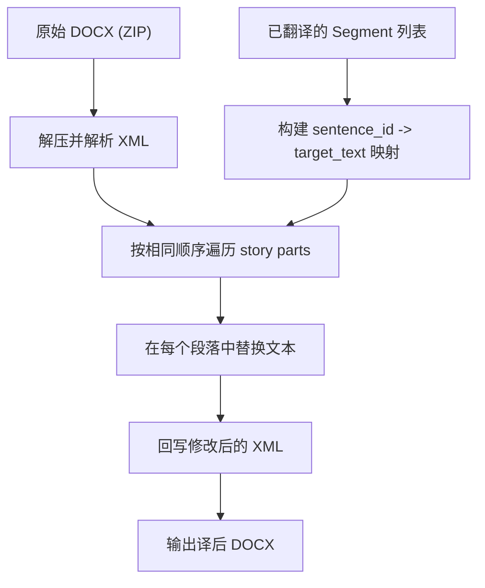

# DOCX 完整解析与导出方案

## 一、现状分析

### 已有能力（document_workspace.py 已实现）

当前 [document_workspace.py](app/services/document_workspace.py) 已基于 `xml.etree.ElementTree` + `zipfile`（纯标准库，无跨平台问题）实现了较完善的解析：

- 正文段落（`w:p`）：包括文本、格式（粗体/斜体/下划线/颜色/字号/字体等）
- 表格（`w:tbl`）：行/列/单元格合并/背景色/对齐
- 页眉/页脚（`headerReference`/`footerReference`）
- 脚注/尾注（`word/footnotes.xml`/`word/endnotes.xml`）
- 文本框（`w:txbxContent`）及 DrawingML 图形中的文字（`a:t` fallback）
- 超链接（`w:hyperlink`）
- 段落样式（对齐/缩进/间距/底纹）
- 结构化文档标记（`w:sdt`）、修订标记（`w:ins`/`w:moveTo`）等

**不使用 pywin32**，完全跨平台兼容。

### 核心缺口

1. **译后 DOCX 导出功能完全缺失** — 当前只有 HTML 预览，无法生成保留原始格式的译后 Word 文档
2. **匹配结果对齐 bug** — `_prepare_sentences` 会跳过 normalize 为空的句段，导致 `zip(segments, match_results)` 错位
3. **去重问题** — 需要确认文档段落导入和模糊匹配流程中不存在不当去重

### 分句逻辑现状

[sentence_splitter.py](app/services/sentence_splitter.py) 的 `SENTENCE_ENDINGS = "。？?"` 按中文句号、问号断句，加上连续换行（2+ `\n`）和段落边界（每个 `<w:p>` 独立处理），这与需求一致。

---

## 二、解决方案

### 2.1 新增 DOCX 导出服务（核心工作量）

创建 [app/services/document_exporter.py](app/services/document_exporter.py)，核心思路：

**「基于原始 DOCX 做 XML 原地替换」** — 保留原始 ZIP 包中的所有文件（样式、主题、图片、关系等），只修改包含文本的 XML 部分。

**文本替换策略**：

1. 使用与解析时完全相同的遍历顺序（headers -> body -> footnotes/endnotes -> footers），使用相同的 `sentence_counter` 逻辑
2. 对每个段落（`<w:p>`），收集所有 `<w:r>` 中的文本，拼接后用 `split_sentence_spans` 得到相同的句界
3. 对每个句段，查找对应的 `sentence_id`，获取 `target_text`
4. 将译文写回 XML runs：在句段对应的第一个 `<w:t>` 写入完整译文，清空后续同句段的 `<w:t>`（保留 run 的格式属性不变）

这样做的效果：

- 段落级别的格式（对齐/缩进/间距）100% 保留
- Run 级别的格式（字体/粗体/颜色等）保留首 run 格式应用于整个译文句段
- 表格结构、页眉页脚、脚注尾注、文本框等全部保留

**命名空间处理**：写回 XML 时需先 `ET.register_namespace` 注册所有 OOXML 命名空间，避免 ElementTree 生成 `ns0:` 前缀。

### 2.2 修复匹配结果对齐 bug

在 [app/services/matcher.py](app/services/matcher.py) 的 `match_sentences_with_stats` 中，`_prepare_sentences` 会丢弃 normalize 为空的句段，导致返回的 results 数量少于输入 sentences 数量，后续 `zip(segments, match_results)` 产生错位。

**修复方案**：`_prepare_sentences` 为空句段也生成占位 `PreparedSentence`，或在 `match_sentences_with_stats` 中对原始 sentences 做索引映射，确保输出长度与输入一致。

### 2.3 确认去重逻辑正确

经审计，当前流程中：

- **文档段落导入**：`parse_docx_workspace` 为每个文本片段独立生成 segment，相同文本的不同出现位置各有独立的 `sentence_id`、`block_index`、`row_index`、`cell_index` — **无去重，正确**
- **匹配阶段**：`_resolve_matches` 为每个 `PreparedSentence` 独立查找匹配 — **无去重，正确**
- `**_find_exact_matches` 中的 set**：仅用于减少 DB 查询条数（去重查询键），不影响每个句段独立获取匹配结果 — **正确**

结论：当前的文档导入和匹配流程不存在不当去重。如有疑虑，可在匹配入口添加日志确认 `len(results) == len(segments)`。

### 2.4 添加导出 API 和 UI 入口

- **API 端点**：在 [app/routers/api.py](app/routers/api.py) 添加 `GET /api/file-records/{id}/export-docx`
  - 从存储加载原始 DOCX 字节
  - 从数据库加载该文件的所有已翻译 Segment
  - 调用 `document_exporter.export_translated_docx(raw_bytes, segments)` 生成译后 DOCX
  - 以 `StreamingResponse` + `Content-Disposition: attachment` 返回下载
- **Web 端点**：在 [app/routers/web.py](app/routers/web.py) 添加 `GET /tasks/{id}/export`，同样逻辑
- **UI 按钮**：在 [app/templates/result.html](app/templates/result.html) 的任务详情页添加「导出译文 DOCX」下载按钮

### 2.5 OMML 数学公式保护设计

- **解析阶段**：把 `m:oMath` / `m:oMathPara` 视为原子片段，不再递归吸收内部 `m:t` 文本；`source_text` 使用 `⟦MATH_n⟧` 占位符，预览层把原始 OMML 转成 MathML 显示。
- **段内映射**：为每个句段记录 `math_placeholders`，保存 `⟦MATH_n⟧ -> 原始 OMML XML` 的映射，供后续导出阶段回写。
- **导出阶段**：导出时不能把占位符直接写成普通 `<w:t>` 文本，而是需要按译文中的占位符顺序，把原始 OMML 节点插回对应位置，仅替换占位符之间的普通文本 run。
- **命名空间**：导出回写前需要确保数学命名空间 `m` 已注册，避免 ElementTree 把 OMML 节点写成匿名前缀。
- **本次范围**：当前版本先落地“解析占位 + 预览 MathML + LLM 保留占位符约束”，导出回写逻辑仍按上述设计继续补齐。

---

## 三、涉及的文件变更

| 文件                                  | 操作  | 说明             |
| ----------------------------------- | --- | -------------- |
| `app/services/document_exporter.py` | 新建  | 核心导出逻辑         |
| `app/services/matcher.py`           | 修改  | 修复空句段导致的对齐 bug |
| `app/routers/api.py`                | 修改  | 添加导出 API 端点    |
| `app/routers/web.py`                | 修改  | 添加导出 Web 端点    |
| `app/templates/result.html`         | 修改  | 添加导出按钮         |

---

## 四、技术选型说明

- **不引入新依赖**：导出功能完全基于 `xml.etree.ElementTree` + `zipfile`（标准库），与解析保持一致
- **不使用 pywin32**：全流程纯 Python，可在 Linux/macOS 服务器上运行
- **不使用 python-docx 做导出**：python-docx 对文本框、图形内文字、脚注尾注等的写入支持有限，直接操作 XML 更可靠

