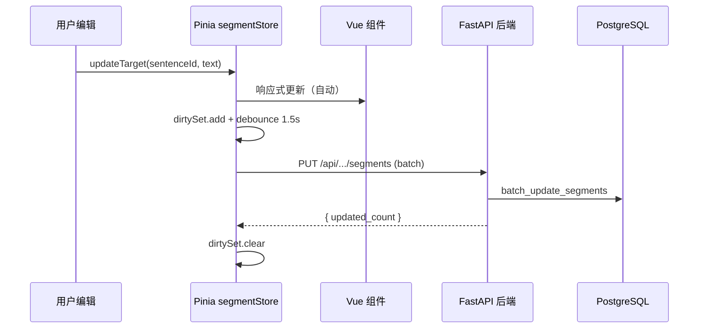

# Vue 3 + Pinia + 用户认证 全栈优化方案

## 一、当前架构痛点分析

- `**result.html` 1283 行**内联 JS，手动 DOM 操作（`querySelector`、`contenteditable`、`Map` 维护状态），无响应式绑定，修改无法自动同步到后端
- **无状态管理**：`modifiedEntries`、`cellMap`、`metaMap` 等散落在全局变量中，页面刷新即丢失
- **无用户系统**：所有 API 完全开放（`CORS: allow_origins=["*"]`）
- **SSR + MPA**：每次导航整页刷新，无法保持工作上下文

## 二、整体架构设计

```mermaid
graph TB
    subgraph frontend [Vue 3 SPA - /frontend]
        Vite[Vite Dev/Build]
        Router[Vue Router]
        subgraph stores [Pinia Stores]
            AuthStore[authStore]
            TaskStore[taskStore]
            SegmentStore[segmentStore]
            TMStore[tmStore]
        end
        subgraph views [Views]
            LoginView[LoginView]
            TaskListView[TaskListView]
            WorkbenchView[WorkbenchView]
        end
    end
    subgraph backend [FastAPI Backend]
        AuthRouter[/api/auth/*]
        APIRouter[/api/file-records/*]
        AuthMiddleware[JWT 鉴权中间件]
        UserModel[User Model]
        ExistingModels[FileRecord/Segment/TM]
    end
    subgraph db [PostgreSQL]
        UsersTable[users 表]
        ExistingTables[file_records/segments/translation_memory]
    end

    frontend -->|HTTP + JWT| backend
    AuthMiddleware --> AuthRouter
    AuthMiddleware --> APIRouter
    UserModel --> UsersTable
    ExistingModels --> ExistingTables
```


## 三、后端改造（FastAPI 侧）

### 3.1 新增 User 模型

在 [app/models.py](app/models.py) 中新增：

```python
class User(Base):
    __tablename__ = "users"

    id: Mapped[uuid.UUID] = mapped_column(Uuid(as_uuid=True), primary_key=True, default=uuid.uuid4, server_default=UUID_SQL_DEFAULT)
    username: Mapped[str] = mapped_column(String(50), unique=True, nullable=False)
    hashed_password: Mapped[str] = mapped_column(String(255), nullable=False)
    role: Mapped[str] = mapped_column(String(20), nullable=False, default="user")  # "admin" | "user"
    is_active: Mapped[bool] = mapped_column(default=True)
    created_at: Mapped[DateTime] = mapped_column(DateTime(timezone=False), server_default=func.now(), nullable=False)
```

- `role` 字段：`admin`（超级管理员）和 `user`（普通用户）两种角色
- 密码使用 `passlib[bcrypt]` 哈希存储

### 3.2 新增认证模块

新建 `app/auth.py`，核心职责：

- **密码哈希**：`passlib` + bcrypt
- **JWT 签发/验证**：`python-jose[cryptography]`，token 有效期可配置
- **依赖注入**：`get_current_user` 作为 FastAPI `Depends`，解析请求中的 `Authorization: Bearer <token>`
- **角色校验**：`require_admin` 依赖，校验 `role == "admin"`

### 3.3 新增认证路由

新建 `app/routers/auth.py`，挂载到 `/api/auth`：


| 端点                   | 方法   | 说明                       |
| -------------------- | ---- | ------------------------ |
| `/api/auth/register` | POST | 注册（仅 admin 可调用，或初始化时开放）  |
| `/api/auth/login`    | POST | 登录，返回 JWT access_token   |
| `/api/auth/me`       | GET  | 获取当前用户信息                 |
| `/api/auth/init`     | POST | 首次启动时创建 admin 账号（表空时才可用） |


### 3.4 现有 API 加鉴权

在 [app/routers/api.py](app/routers/api.py) 的各路由上加 `Depends(get_current_user)`。敏感操作（如删除任务）可加 `Depends(require_admin)`。

### 3.5 新增依赖

在 [requirements.txt](requirements.txt) 中追加：

```
passlib[bcrypt]
python-jose[cryptography]
```

### 3.6 数据库迁移脚本

新建 `scripts/create_users_table.sql`：

```sql
CREATE TABLE IF NOT EXISTS users (
    id UUID PRIMARY KEY DEFAULT gen_random_uuid(),
    username VARCHAR(50) UNIQUE NOT NULL,
    hashed_password VARCHAR(255) NOT NULL,
    role VARCHAR(20) NOT NULL DEFAULT 'user',
    is_active BOOLEAN NOT NULL DEFAULT TRUE,
    created_at TIMESTAMP NOT NULL DEFAULT NOW()
);
```

### 3.7 配置扩展

在 [app/config.py](app/config.py) 的 `Settings` 中增加：

```python
jwt_secret_key: str = "change-me-in-production"
jwt_algorithm: str = "HS256"
jwt_expire_minutes: int = 1440  # 24小时
```

## 四、前端重构（Vue 3 SPA）

### 4.1 项目初始化

在根目录下新建 `frontend/`，使用 Vite + Vue 3 + TypeScript：

```
frontend/
  src/
    api/           # axios 实例 + 请求拦截器（自动附 JWT）
    stores/        # Pinia stores
    views/         # 页面组件
    components/    # 通用组件
    router/        # Vue Router
    types/         # TypeScript 类型定义
    App.vue
    main.ts
  vite.config.ts   # dev proxy -> localhost:19003
```

### 4.2 Pinia Store 设计（核心：页面修改同步数据库）

这是解决"页面渲染元素修改同步到数据库"的关键：

`**segmentStore**` — 管理当前任务的所有句段状态：

```typescript
// stores/segment.ts
export const useSegmentStore = defineStore('segment', () => {
  const segments = ref<Map<string, Segment>>(new Map())
  const dirtySet = ref<Set<string>>(new Set())   // 已修改未保存的 sentenceId
  const saving = ref(false)

  // 用户编辑译文 -> 立即更新本地状态 + 标记 dirty
  function updateTarget(sentenceId: string, targetText: string) {
    const seg = segments.value.get(sentenceId)
    if (seg) {
      seg.target_text = targetText
      seg.source = 'manual'
      dirtySet.value.add(sentenceId)
    }
    debouncedSync()  // 防抖 1.5s 后自动同步到后端
  }

  // 批量同步到后端（PUT /api/file-records/{id}/segments）
  async function syncToBackend() { /* ... */ }

  // SSE 流式更新（LLM 翻译结果实时写入 store -> 视图自动更新）
  async function startLLMTranslation(scope: string) { /* ... */ }
})
```

数据流如下：




`**authStore**` — 管理登录状态和 JWT：

```typescript
// stores/auth.ts
export const useAuthStore = defineStore('auth', () => {
  const token = ref(localStorage.getItem('token'))
  const user = ref<User | null>(null)

  async function login(username: string, password: string) { /* ... */ }
  function logout() { /* ... */ }
  const isAdmin = computed(() => user.value?.role === 'admin')
})
```

`**taskStore**` — 管理任务列表、上传、删除。

### 4.3 路由与视图

```typescript
// router/index.ts
const routes = [
  { path: '/login', component: LoginView },
  { path: '/', component: TaskListView, meta: { requiresAuth: true } },
  { path: '/tasks/:id', component: WorkbenchView, meta: { requiresAuth: true } },
]
```

- **LoginView**：登录表单，调用 `authStore.login()`
- **TaskListView**：对应当前 `tasks.html`，任务列表 + 上传 + 删除
- **WorkbenchView**：对应当前 `result.html`，翻译工作台（核心重构页面）
  - 左侧：句段表格（`contenteditable` -> Vue `v-model` 或受控 input）
  - 右侧：原文 DOCX 预览面板
  - 底部：操作面板（保存/LLM翻译/导出）

### 4.4 API 层封装

```typescript
// api/index.ts
const http = axios.create({ baseURL: '/api' })

http.interceptors.request.use(config => {
  const token = localStorage.getItem('token')
  if (token) config.headers.Authorization = `Bearer ${token}`
  return config
})

http.interceptors.response.use(
  res => res,
  err => {
    if (err.response?.status === 401) {
      // token 过期 -> 跳转登录
      useAuthStore().logout()
      router.push('/login')
    }
    return Promise.reject(err)
  }
)
```

### 4.5 开发环境代理

`vite.config.ts` 配置 proxy，开发时前端 `localhost:5173` 代理 API 到后端 `localhost:19003`：

```typescript
server: {
  proxy: {
    '/api': { target: 'http://localhost:19003', changeOrigin: true }
  }
}
```

### 4.6 生产部署

`npm run build` 输出到 `frontend/dist/`，FastAPI 用 `StaticFiles` 挂载：

```python
# main.py
app.mount("/", StaticFiles(directory="frontend/dist", html=True), name="spa")
```

## 五、性能提升要点


| 问题                       | 解决方案                                 |
| ------------------------ | ------------------------------------ |
| 全页刷新丢失状态                 | Vue Router SPA，导航不刷新                 |
| 手动 DOM 操作性能差             | Vue 虚拟 DOM + 响应式系统                   |
| 1283 行 result.html 内联 JS | 拆分为组件 + Store，关注点分离                  |
| 每次编辑无法自动同步               | Pinia Store + debounce 批量同步          |
| 大量句段渲染卡顿                 | 虚拟滚动（`vue-virtual-scroller`），仅渲染可视区域 |
| SSE 解析手写复杂               | 封装为 composable，Store 驱动视图自动更新        |


## 六、迁移策略（渐进式）

建议分三个阶段推进，**旧页面保留到新页面完全可用后再移除**：

1. **Phase 1**：后端加 User 模型 + JWT 认证 + 认证路由（不影响现有功能，现有页面暂不加鉴权）
2. **Phase 2**：搭建 Vue 前端骨架（Vite + Router + Pinia + Auth 页面 + 任务列表页），和现有 `/api/`* 对接
3. **Phase 3**：重构翻译工作台页面（最复杂，将 `result.html` 的所有功能迁移到 `WorkbenchView`），包括 segmentStore 实时同步、SSE 集成、虚拟滚动

## 七、文件变更清单

### 新增文件

- `app/auth.py` — JWT + 密码工具 + 依赖注入
- `app/routers/auth.py` — 认证路由
- `scripts/create_users_table.sql` — 建表脚本
- `frontend/` — 整个 Vue 3 前端工程

### 修改文件

- [app/models.py](app/models.py) — 新增 `User` 模型
- [app/config.py](app/config.py) — 新增 JWT 配置项
- [app/main.py](app/main.py) — 注册 auth 路由 + 挂载 SPA 静态文件
- [app/routers/api.py](app/routers/api.py) — 各端点加 `Depends(get_current_user)`
- [requirements.txt](requirements.txt) — 新增 `passlib[bcrypt]`、`python-jose[cryptography]`

