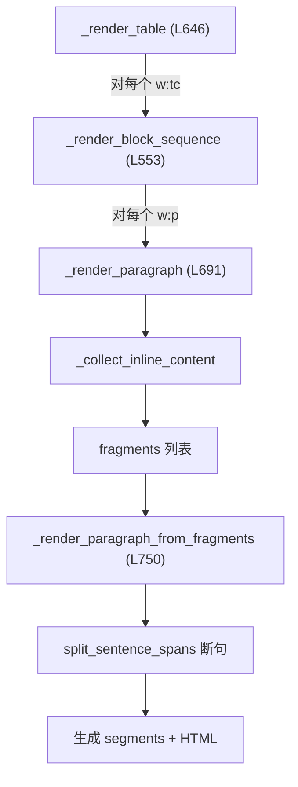

# 表格单元格碎片段落合并方案

## 问题根因

Word OOXML 格式中，表格单元格 `<w:tc>` 内每次用户按回车都会产生一个新的 `<w:p>` 元素。当前代码在 `[_render_block_sequence](app/services/document_workspace.py)` (L553) 中对每个 `<w:p>` 独立调用 `_render_paragraph`，各段落独立进行断句和分段，导致：

```
单元格内容：
  <w:p> "场价格及库存情况实施采" </w:p>
  <w:p> "购" </w:p>

当前输出段 segments：
  segment 1: "场价格及库存情况实施采"
  segment 2: "购"
```

"购" 会被单独发给 LLM 翻译，结果不可控。

## 数据流




问题出在 B->C 这一步：每个 `<w:p>` 独立走完整个流程，没有跨段落合并的机会。

## 解决方案：单元格级别段落预合并

**核心思路**：在 `_render_table` 处理每个单元格时，先收集所有段落的 inline fragments，根据合并启发式规则将"碎片段落"合并为一组 fragments，再统一送入 `_render_paragraph_from_fragments` 进行断句。

### 修改 1：新增合并判断函数

在 [document_workspace.py](app/services/document_workspace.py) 中新增：

```python
CELL_SENTENCE_END_CHARS = frozenset("。？！?!.；;:：\u3002\uff01\uff1f")

def _cell_paragraph_looks_incomplete(fragments: list[InlineFragment]) -> bool:
    """判断一组 fragments 的文本是否看起来像未结束的句子片段。"""
    text = "".join(f.display_text for f in fragments).rstrip()
    if not text:
        return False
    return text[-1] not in CELL_SENTENCE_END_CHARS
```

### 修改 2：新增段落分组合并函数

```python
def _group_cell_paragraphs(
    paragraphs: list[ET.Element],
    story: StoryPart,
    sentence_counter,
    block_counter,
    numbering_state: NumberingState,
) -> list[list[InlineFragment]]:
    """
    将单元格中连续的碎片段落合并为若干组 fragments。
    规则：
    - 如果当前段落文本不以句末标点结尾，且下一个段落文本较短，则合并
    - 有编号的段落不参与向前合并（认为是独立条目）
    - 合并时在两段间插入换行标记以保留视觉分隔
    """
```

### 修改 3：重构 `_render_table` 中的单元格处理

当前 `_render_table` (L646-688) 中对每个单元格直接调用 `_render_block_sequence`。改为：

1. 遍历单元格内的 block nodes
2. 对连续的 `<w:p>` 元素，收集各自的 inline fragments
3. 调用 `_group_cell_paragraphs` 进行分组合并
4. 对每组合并后的 fragments 调用 `_render_paragraph_from_fragments` 生成统一的 segment 和 HTML
5. 遇到内嵌表格 `<w:tbl>` 时 flush 当前分组，独立处理

### 合并启发式规则

判断是否合并相邻段落的规则（按优先级）：

- **不合并**：下一段有编号前缀（numbering），说明是列表项
- **不合并**：当前段以句末标点结尾（。？！?!. 等）
- **不合并**：下一段文本过长（> 50 字符），可能是独立段落
- **合并**：当前段不以句末标点结尾 且 下一段较短（<= 20 字符）
- **合并**：当前段不以句末标点结尾 且 合并后总长度仍合理（<= 200 字符）

这些阈值可以用常量定义，方便后续调整。

### 修改 4：保持 HTML 视觉一致性

合并后的 fragments 在段落间插入一个 `InlineFragment(display_text="\n", source_text="\n")`，这样：

- `split_sentence_spans` 遇到单个 `\n` 不会断句（当前逻辑只在连续 2+ 个换行时才断句）
- 视觉上通过 CSS `white-space` 或 `<br>` 保持换行效果

### 涉及文件

- [app/services/document_workspace.py](app/services/document_workspace.py) -- 主要修改文件
  - 新增 `_cell_paragraph_looks_incomplete()` 
  - 新增 `_group_cell_paragraphs()` 
  - 修改 `_render_table()` 单元格处理逻辑
- [app/services/sentence_splitter.py](app/services/sentence_splitter.py) -- 无需修改（单个 `\n` 已经不会触发断句）

### 预期效果

修改前：

- segment 1: "场价格及库存情况实施采" -> 单独翻译
- segment 2: "购" -> 单独翻译

修改后：

- segment 1: "场价格及库存情况实施采购" -> 整句翻译

